# Gallery

Each preview below is the first page of an example in [`examples/`](https://github.com/nbprint/nbprint/tree/main/examples), rendered with `nbprint <example> ++outputs.target=html`. Click a preview to open the full report. The HTML is the same file nbprint writes locally: your browser runs the pagination, so you can scroll through every page, inspect the DOM, or print it to PDF.

## YAML reports

These are built entirely from a YAML configuration.

<figure><figcaption><strong>basic</strong>: title page, table of contents, and code-generated content. <a href="https://github.com/nbprint/nbprint/blob/main/examples/basic.yaml">source</a></figcaption></figure>
<figure><a href="../../gallery/finance.html">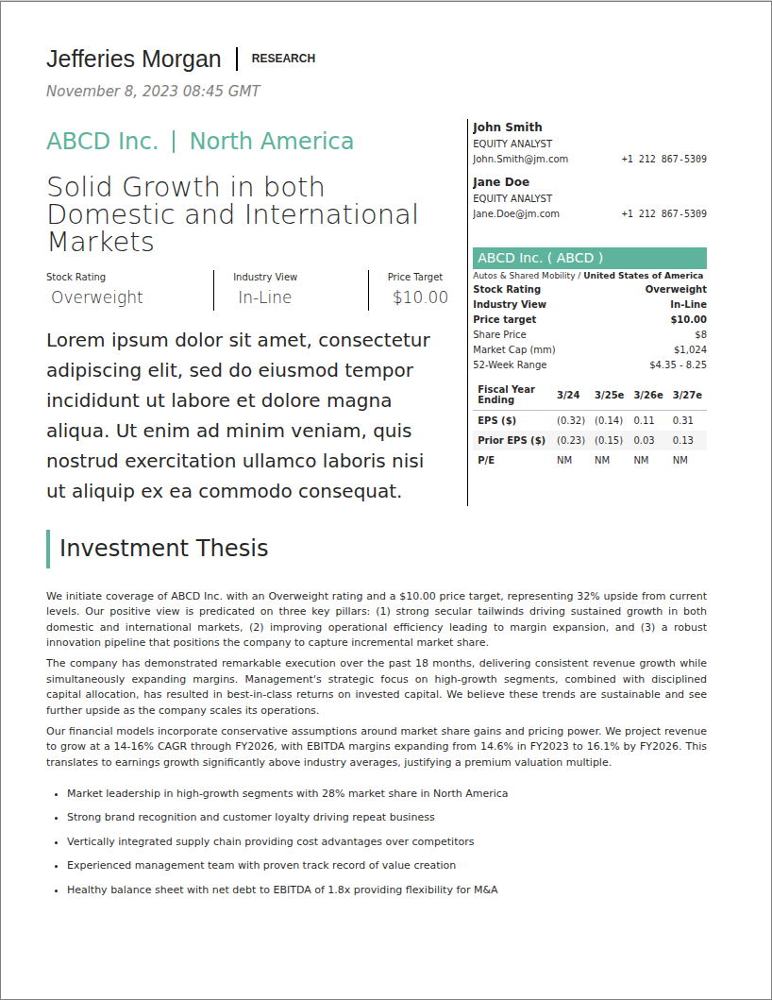</a><figcaption><strong>finance</strong>: an equity research note with a ratings sidebar. <a href="https://github.com/nbprint/nbprint/blob/main/examples/finance.yaml">source</a></figcaption></figure>
<figure><a href="../../gallery/research.html">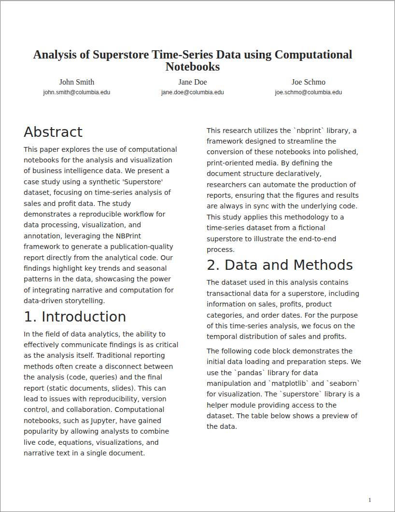</a><figcaption><strong>research</strong>: a two-column academic paper with authors and abstract. <a href="https://github.com/nbprint/nbprint/blob/main/examples/research.yaml">source</a></figcaption></figure>
<figure><a href="../../gallery/chapters.html">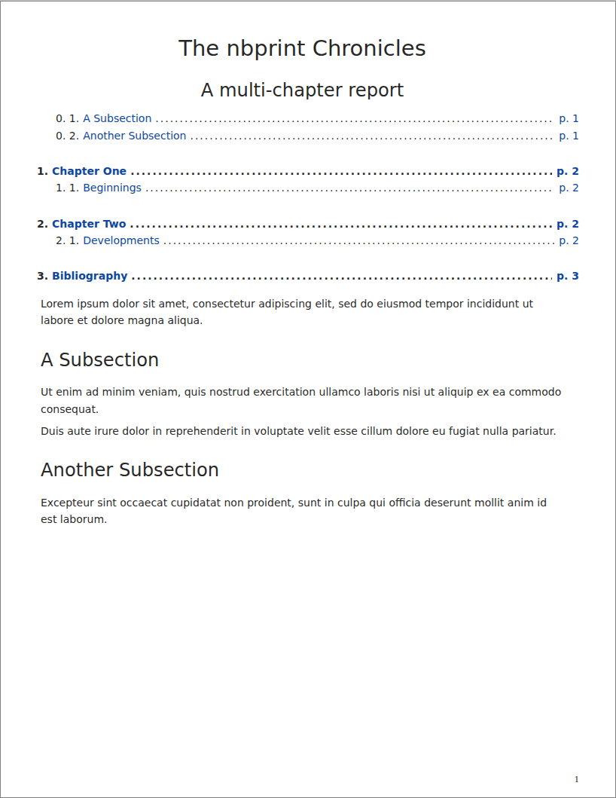</a><figcaption><strong>chapters</strong>: a multi-chapter book with a nested table of contents. <a href="https://github.com/nbprint/nbprint/blob/main/examples/chapters.yaml">source</a></figcaption></figure>
<figure><a href="../../gallery/sections.html">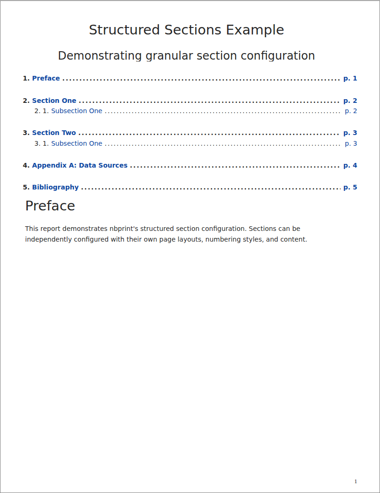</a><figcaption><strong>sections</strong>: front, middle and back matter with per-section numbering. <a href="https://github.com/nbprint/nbprint/blob/main/examples/sections.yaml">source</a></figcaption></figure>
<figure><a href="../../gallery/inline.html">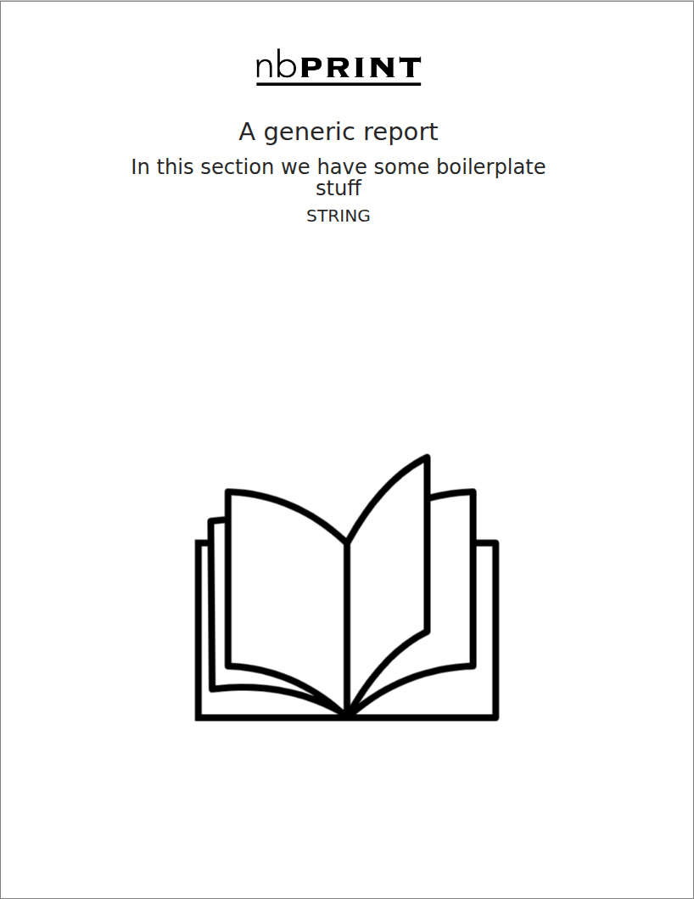</a><figcaption><strong>inline</strong>: a cover page, footer logo and page counter from a custom page model. <a href="https://github.com/nbprint/nbprint/blob/main/examples/inline.yaml">source</a></figcaption></figure>
<figure><a href="../../gallery/landscape.html">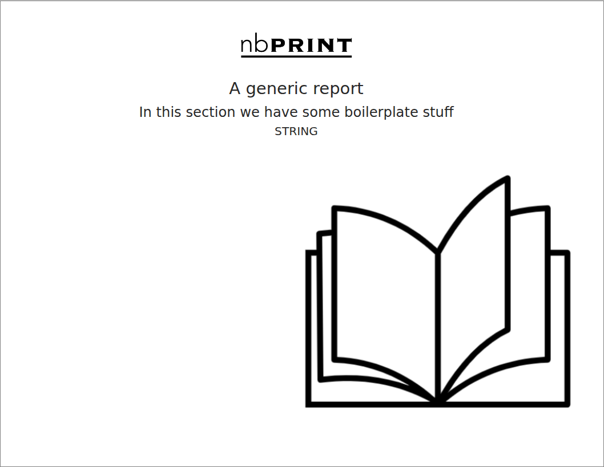</a><figcaption><strong>landscape</strong>: the same report in landscape orientation. <a href="https://github.com/nbprint/nbprint/blob/main/examples/landscape.yaml">source</a></figcaption></figure>
<figure><a href="../../gallery/plotly.html">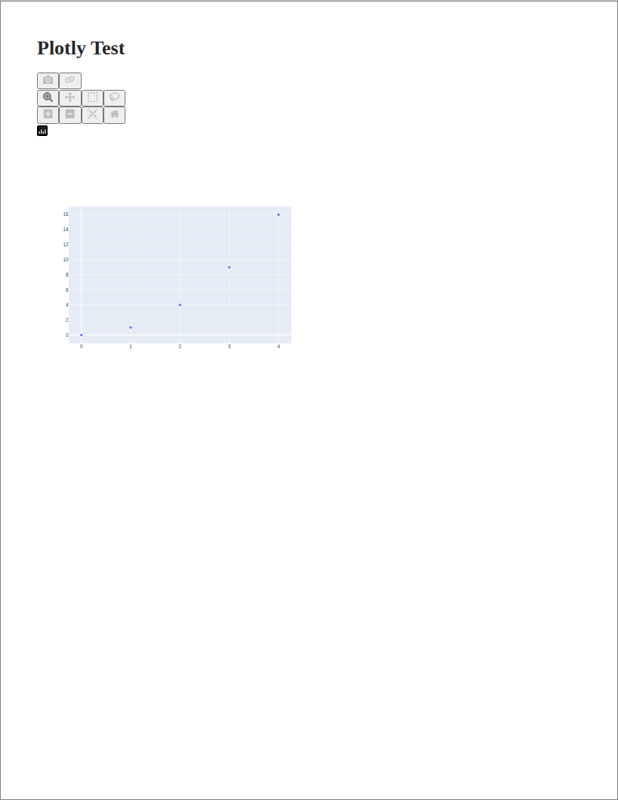</a><figcaption><strong>plotly</strong>: interactive Plotly figures laid out on printed pages. <a href="https://github.com/nbprint/nbprint/blob/main/examples/plotly.yaml">source</a></figcaption></figure>
<figure><a href="../../gallery/greattables.html">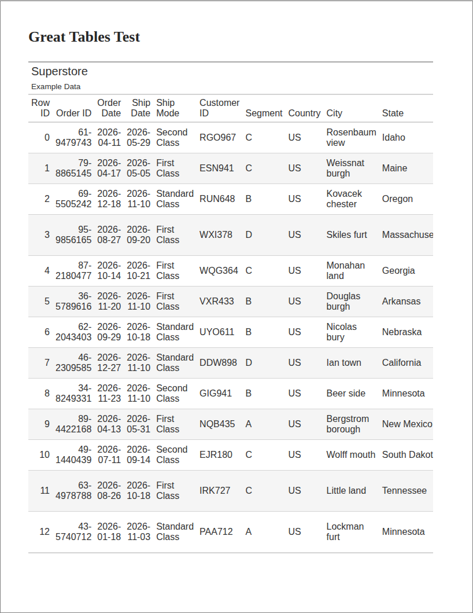</a><figcaption><strong>greattables</strong>: a long <code>great_tables</code> table split across pages. <a href="https://github.com/nbprint/nbprint/blob/main/examples/greattables.yaml">source</a></figcaption></figure>

## Notebook reports

These start from an existing notebook and drive layout from cell tags, cell metadata and the runtime API.

<figure><a href="../../gallery/notebook-sections.html">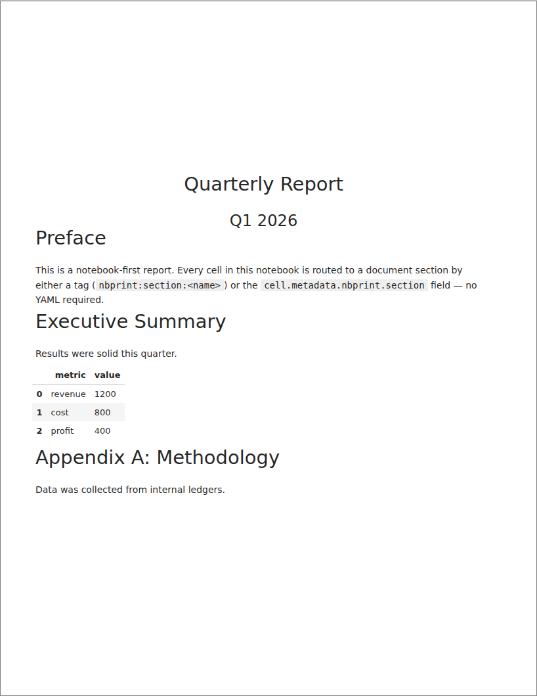</a><figcaption><strong>notebook-sections</strong>: cells routed into sections with tags and metadata. <a href="https://github.com/nbprint/nbprint/blob/main/examples/notebook-sections.ipynb">source</a></figcaption></figure>
<figure><a href="../../gallery/notebook-runtime.html">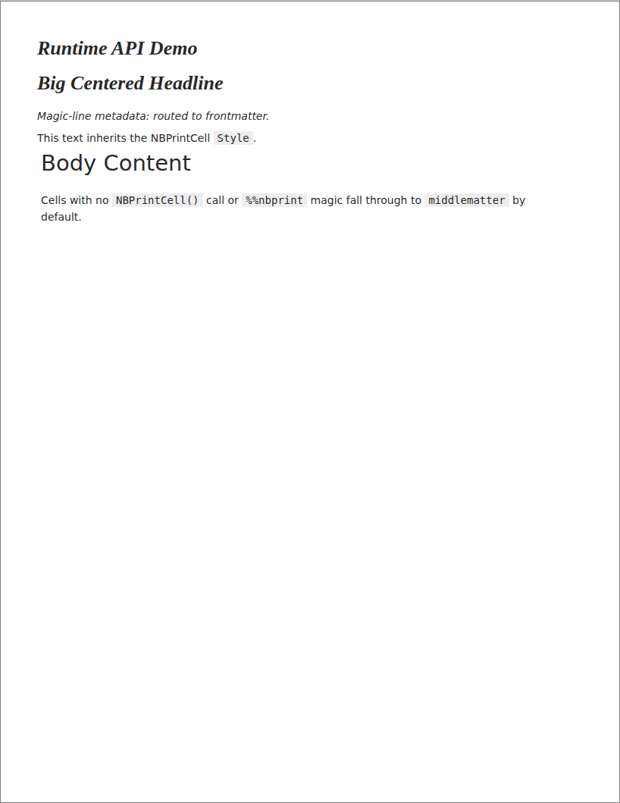</a><figcaption><strong>notebook-runtime</strong>: <code>NBPrintCell</code> and the <code>%%nbprint</code> magic. <a href="https://github.com/nbprint/nbprint/blob/main/examples/notebook-runtime.ipynb">source</a></figcaption></figure>
<figure><a href="../../gallery/notebook-overlays.html">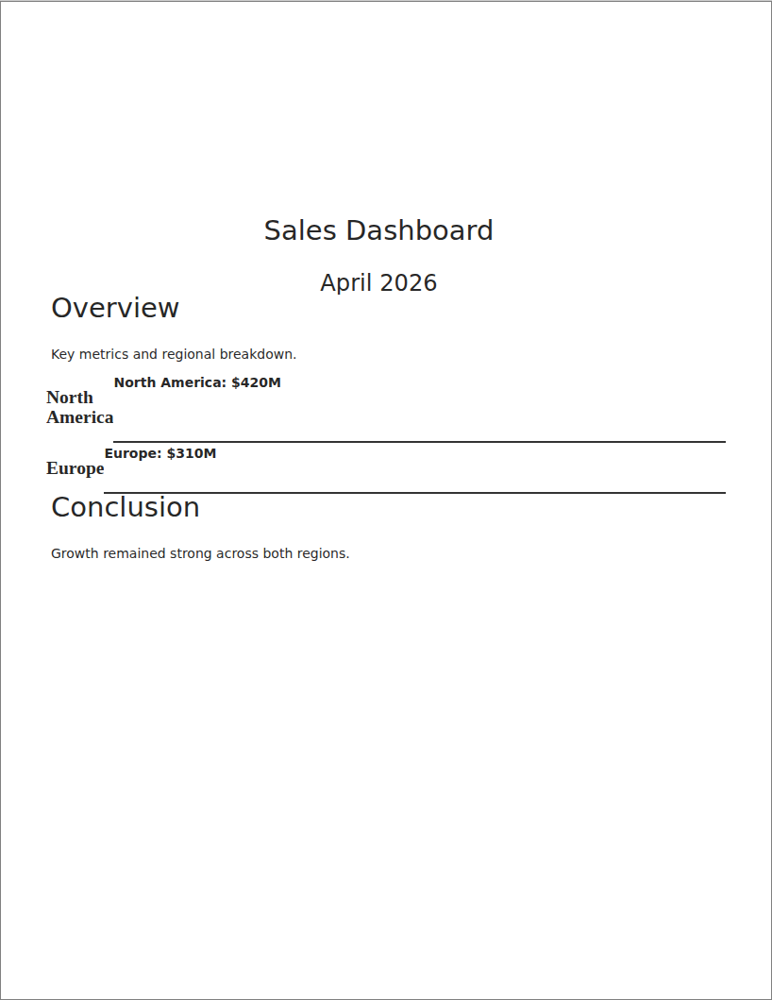</a><figcaption><strong>notebook-overlays</strong>: formatting overlays applied to ranges of cells. <a href="https://github.com/nbprint/nbprint/blob/main/examples/notebook-overlays.ipynb">source</a></figcaption></figure>
<figure><a href="../../gallery/notebook-page-boxes.html">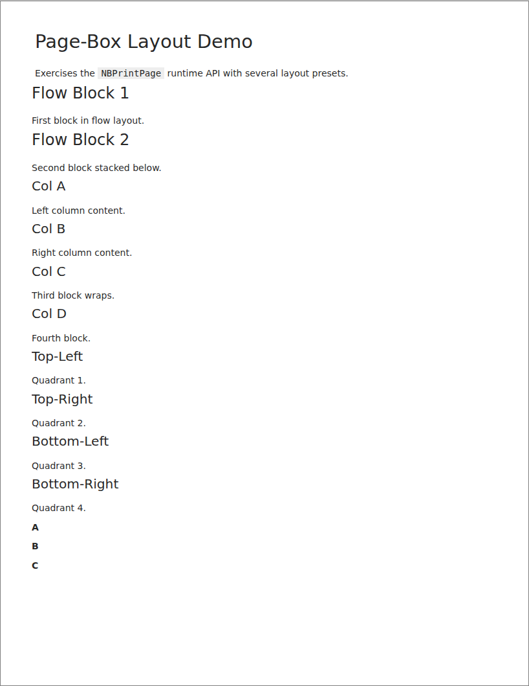</a><figcaption><strong>notebook-page-boxes</strong>: <code>NBPrintPage</code> page-box layouts. <a href="https://github.com/nbprint/nbprint/blob/main/examples/notebook-page-boxes.ipynb">source</a></figcaption></figure>

To rebuild the gallery locally, run `python docs/gallery.py` from the repository root, then `yardang build`.
